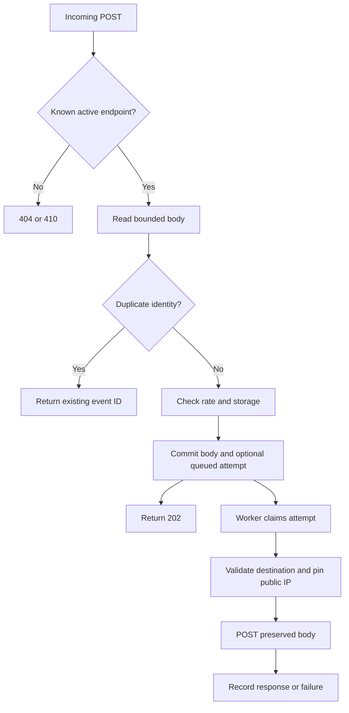

# Workflows and lifecycle

Baseline: 2026-10-12. Exact data/API contracts are in [backend.md](backend.md); UI behavior is in [frontend.md](frontend.md).

## User journey

1. Start locally; first-time user chooses a workspace password, otherwise signs in.
2. Create an endpoint: capture-only, HTTPS forwarding, or explicit simulator.
3. Copy its receiving URL and POST from a reachable process. External services require a reachable HTTPS deployment or tunnel.
4. Find the event, inspect body/header evidence and attempt response.
5. Fix the receiver, request a manual replay, acknowledge possible duplicate effects, and inspect the new attempt without losing history.
6. Pause an endpoint or delete unneeded event/history data.

## Receive and deliver

The capture transaction serializes quota/deduplication checks. Capture-only ends after persistence. A simulator bypasses external networking and is explicitly synthetic.

## Attempt state transitions

`queued → sending → delivered | failed`. Sending leases last 120 seconds; an expired lease can be reclaimed with an incremented execution count. A manual replay creates a new queued attempt using the endpoint's current destination; it does not change an old attempt into success. Concurrent pending replay insertion is rejected with 409.

There is no automatic retry policy for ordinary HTTP failures. Restart recovery is at-least-once with respect to receiver effects: the receiver may accept a request before the worker stops recording it. Stable event identity supports receiver-side deduplication but cannot enforce it.

## Authentication

Setup is one-time and restricted to local clients; terminal setup is available for containers. Password verification grants an opaque cookie backed by a hash and 12-hour expiry. Logout deletes the session. Management operations require a session; hook submission does not. Session expiry sends the user back to sign-in. Browser mutation origins are checked when present.

## Important failures and recovery

Payload over limit: 413. New-event rate exceeded: 429. Logical workspace quota: 507. Invalid destination: 422 at configuration or failed attempt during resolution/delivery. TLS/socket/response deadline errors become failed attempts. Redirects are recorded without following them. If backend refresh fails, the UI reports a disconnected state; pausing live polling does not pause capture.

Hourly cleanup deletes old event records and cascades their attempts, and removes expired sessions. Deleting an endpoint also removes its events; it cannot cancel a request already sent. Filesystem reclamation and backups have a separate lifecycle.
